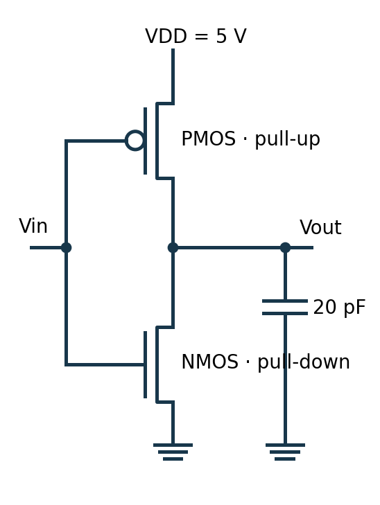
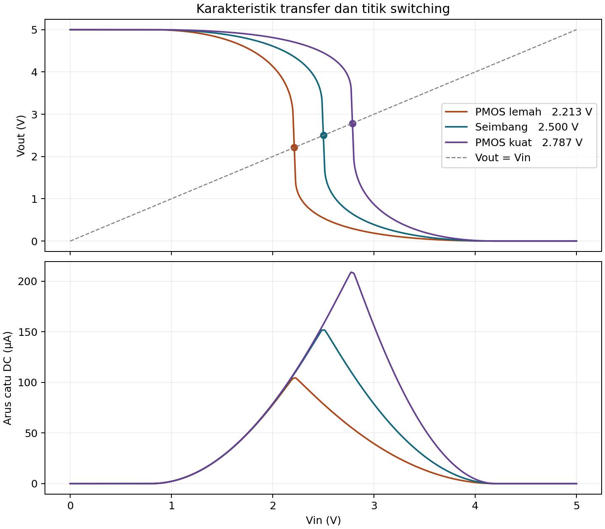
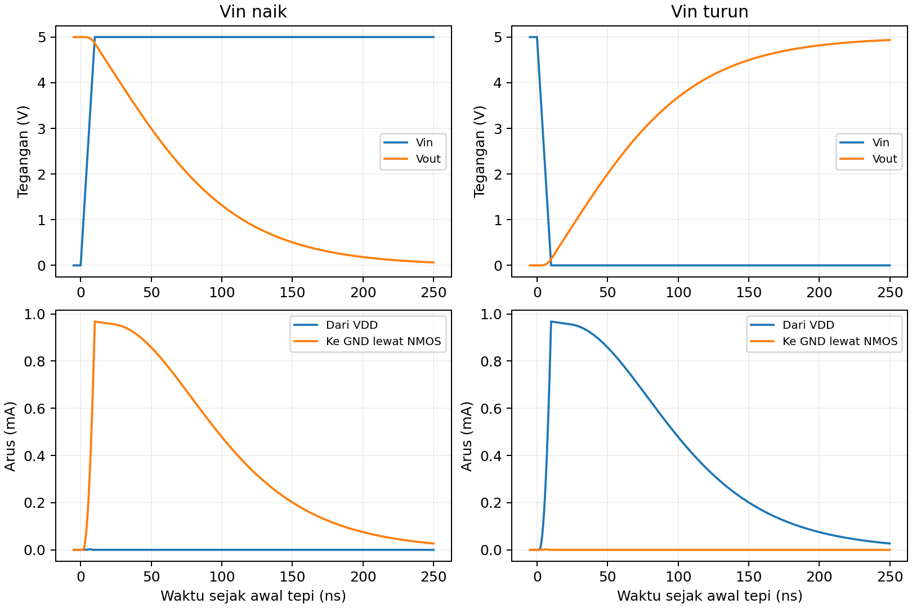

# D1.2 | Inverter CMOS | 09.00–10.15

**Intuisi.** Satu Vin mengendalikan dua gerbang sekaligus. Saat Vin naik, NMOS makin kuat menarik output ke ground, sementara kemampuan PMOS menarik output ke VDD berkurang. Di sekitar titik peralihan, perubahan kecil pada Vin menghasilkan perubahan besar pada Vout. Kurva tetap kontinu. Dua daerah datar di ujung kurva memberi level logika yang mudah dibedakan.

## 1. Skema dan prediksi sebelum pengujian



Kedua drain bertemu di Vout. Source dan bulk PMOS terhubung ke VDD, source dan bulk NMOS ke ground. Masukan terhubung ke kedua gate. Kapasitor terpasang antara Vout dan ground.

| Vin | PMOS | NMOS | Prediksi Vout setelah stabil |
|---|---|---|---|
| 0 V | ON | OFF | HIGH, mendekati 5 V |
| 5 V | OFF | ON | LOW, mendekati 0 V |

Prediksi awal: peralihan dekat 2,5 V jika kekuatan efektif kedua transistor seimbang dan magnitudo ambang sama. Memperkuat PMOS seharusnya menggeser titik peralihan ke Vin lebih tinggi karena NMOS memerlukan tegangan gate lebih besar untuk mengimbanginya.

## 2. Model dan tabel parameter

| Parameter | NMOS | PMOS |
|---|---:|---:|
| Model | MOS level-1 | MOS level-1 |
| VTO (ambang model) | +0,8 V | −0,8 V |
| KP | 100 µA/V² | 50 µA/V² |
| Panjang kanal L | 1 µm | 1 µm |
| Lebar kanal W | 1 µm | 1 / 2 / 4 µm |
| LAMBDA | 0,02 V⁻¹ | 0,02 V⁻¹ |

Setiap inverter memakai catu ideal 5 V dan beban 20 pF pada 27 °C. Ketiga inverter menerima Vin yang sama dan memakai sumber catu terpisah agar arus dapat dibaca per variasi. Sweep DC memakai langkah 1 mV dari 0 hingga 5 V (5.001 titik). Analisis transien memakai pulsa 0–5 V, waktu naik dan turun 10 ns, serta langkah waktu maksimum 0,1 ns.

## 3. Hasil DC dan titik switching



| Vin (V) | Vout seimbang (V) | Arus dari VDD, seimbang (µA) |
|---:|---:|---:|
| 0 | ≈ 5 | ≈ 0,000005 |
| 1 | 4,9931 | 2,20 |
| 2 | 4,6109 | 78,64 |
| 2,5 | 2,5000 | 151,73 |
| 3 | 0,3891 | 78,64 |
| 4 | 0,0069 | 2,20 |
| 5 | ≈ 0 | ≈ 0,000005 |

**Pengukuran crossover.** Untuk setiap kurva, hitung Vout − Vin dan interpolasikan titik nol antara sampel yang mengapit perubahan tanda. Kekuatan efektif β = KP × W/L.

| Variasi | W PMOS | βp/βn (magnitudo) | VM terukur saat Vout = Vin |
|---|---:|---:|---:|
| PMOS lebih lemah | 1 µm | 0,5 | 2,213 V |
| Seimbang | 2 µm | 1 | 2,500 V |
| PMOS lebih kuat | 4 µm | 2 | 2,787 V |

VM adalah titik kerja pasangan transistor. VTO adalah parameter ambang sebuah MOSFET relatif terhadap source-nya. Ketiga variasi memakai VTO yang sama, sementara VM bergeser sekitar 0,574 V dari variasi terlemah ke terkuat. Hanya kasus seimbang menghasilkan setengah tegangan catu dalam simulasi ini.

## 4. Arus statik dan arus selama transisi



Pada kedua level logika stabil, arus catu model sekitar 5 pA. Angka sekecil ini dipengaruhi jalur bocor dan konduktansi numerik simulator. Saat Vin ditahan pada 2,5 V, kedua transistor konduktif dan arus DC menjadi 151,73 µA. Pada keadaan DC, arus kapasitor nol.

**Ke mana arus mengalir?** Selama kedua kanal konduktif, ada jalur langsung VDD → PMOS → Vout → NMOS → GND. Selama Vout naik, sebagian arus PMOS juga mengisi kapasitor. Selama Vout turun, kapasitor melepas muatan melalui NMOS. Dengan arah arus pada CSV, Idd − Inmos = C × dVout/dt untuk beban ideal ini.

| Jendela pengukuran, model seimbang | Arus catu puncak dalam jendela | Interpretasi |
|---|---:|---|
| Vin naik, 10–20 ns | 2,52 µA pada 16,65 ns | Pada saat itu NMOS mengalirkan sekitar 350 µA ke ground. Sebagian besar arus berasal dari kapasitor yang sedang dikosongkan. |
| Vin turun, 1.020–1.030 ns | 967,81 µA pada 1.030 ns | Saat Vin mencapai 0 V, NMOS praktis OFF. Hampir seluruh arus catu saat itu mengisi kapasitor. |

Tidak tepat menyamakan seluruh puncak arus catu transien dengan arus konduksi langsung kedua kanal. Kapasitansi memengaruhi waktu naik dan turun keluaran. Sweep DC hanya mencatat keadaan setelah stabil pada setiap Vin.

## 5. Reproduksi dan batas interpretasi

Dari direktori hasil ekstraksi, simulasi ulang dijalankan menggunakan ngspice 47 pada Windowsdan dan Python 3:

```sh
ngspice -b spice/inverter.cir
python3 olah.py
```

Netlist menulis hasil mentah ke results/dc.dat dan results/tran.dat. Skrip mengubahnya menjadi inverter_vtc.csv dan inverter_tran.csv serta membuat kedua grafik. Kolom arus menggunakan ampere, tegangan menggunakan volt, waktu menggunakan detik. Hasil paket dibuat dengan ngspice 44.2. Dokumentasi simulator: https://ngspice.sourceforge.io/docs.html

**Batas model.** Parameter level-1 dipilih untuk demonstrasi. Model ini tidak merepresentasikan transistor sebenarnya dari 8051. VM, arus serta waktu transisi hasil simulasi tidak dapat dijadikan spesifikasi pin AT89S52 atau C8051F330. Batas input pin nyata tetap mengikuti datasheet yang digunakan pada D1.1.
