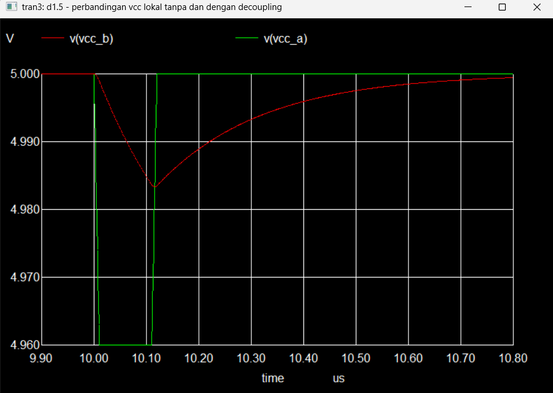

# D1.5 — Mengapa catu 5 V belum menjamin program berjalan?

**Keputusan.** Reset eksternal AT89S52 aktif HIGH. Ukur berapa lama RST masih HIGH sesudah catu masuk rentang operasi dan clock berjalan. Tegangan akhir 5 V saja tidak menjawab pertanyaan itu.

## Persyaratan perangkat

Menurut datasheet AT89S52, pin RST harus HIGH selama dua siklus mesin saat osilator berjalan (§4.7, hlm. 5). Satu siklus mesin terdiri atas 12 periode osilator (hlm. 12), sehingga pada frekuensi 12 MHz, waktu reset minimum setelah clock berjalan adalah 24/12 MHz = 2 µs. Waktu ini baru bisa dihitung setelah tersedia clock. Bagian §14 menjelaskan rangkaian osilator dengan kristal/resonator di XTAL1 dan XTAL2. Untuk pemulihan dari power-down, §16 meminta reset dipertahankan hingga osilator sempat mulai kembali dan stabil. Durasi startup kristal papan ini belum diukur.

Bagian §27 menentukan rentang catu 4,0–5,5 V, VIH(min) pin RST = 0,7 VCC, dan VIL(max) = 0,2 VCC − 0,1 V. Pada 5 V, HIGH dijamin mulai 3,5 V dan LOW hingga 0,9 V. Di antaranya status pembacaan tidak dijamin. Pull-down internal RST berada dalam rentang 50–300 kΩ.

## Clock buffer dan jalur clock AT89S52

Pin XTAL1 merupakan masukan penguat osilator pembalik sekaligus masukan ke rangkaian clock internal. Jika memakai kristal atau resonator, komponen dipasang antara XTAL1 dan XTAL2. Jika memakai sumber clock eksternal, sinyal masuk melalui XTAL1 dan XTAL2 dibiarkan terbuka. Datasheet menjelaskan fungsi antarmuka tersebut tanpa merinci susunan transistor clock buffer internal. Dalam simulasi ini, clock diasumsikan siap 8 ms setelah VCC mencapai 4 V. Pada ramp 1 ms, clock baru siap pada 8,8 ms, sedangkan interval RST HIGH terjamin sudah berakhir sekitar 3,05 ms. Dengan asumsi itu, syarat reset selama dua siklus mesin setelah clock berjalan belum terpenuhi. (AT89S52 doc1919D, hlm. 5–6 dan 19–20.)

## Decoupling pada catu daya

Kapasitor decoupling dipasang dekat pin VCC dan GND untuk memasok arus sesaat ketika rangkaian internal beralih. Selama jalur catu belum dapat memasok tambahan arus tersebut, muatan kapasitor membantu membatasi penurunan tegangan lokal. AT89S52 memiliki rentang operasi 4,0–5,5 V. Pada skenario short dip, VCC turun dari 5 V ke 3 V, sehingga tegangan berada di bawah batas operasi yang dijamin. Dalam reset_rc.cir, kapasitor 1 µF berada pada jalur VCC menuju RST dan berfungsi membentuk pulsa reset. Simulasi memakai sumber tegangan ideal dengan bentuk dip yang sudah ditentukan, sehingga hasilnya belum mengukur pengaruh kapasitor decoupling pada VCC. (AT89S52 doc1919D, hlm. 1 dan 29.)

## Rangkaian dan asumsi

Sumber PWL naik linier 0→5 V. Dari VCC ke RST terpasang kapasitor 1 µF seri dengan 1 kΩ. Dari RST ke ground ada 10 kΩ paralel 100 kΩ (contoh pull-down internal). Dioda ilustratif dari ground (anoda) ke RST membatasi ayunan negatif pada saat catu turun. Karakteristik dioda, R, C dan osilator merupakan asumsi model. Pada startup dingin kapasitor mula-mula kosong; pada kedua uji gangguan kapasitor telah terisi dengan catu awal 5 V. Konstanta waktu saat dioda padam ≈ [1 kΩ + (10 kΩ || 100 kΩ)] × 1 µF = 10,09 ms.

Detektor hipotetis melepas reset ketika RST melintasi 0,5 VCC ke bawah. Clock diasumsikan siap 8 ms sesudah VCC mencapai 4 V. Penanda ini adalah skenario pembanding; kristal dan CPU tidak disimulasikan.

## Hasil startup dari ngspice

| Ramp | VCC mencapai 4 V | Release model | Clock siap asumsi | RST saat clock siap |
|---|---:|---:|---:|---:|
| 1 ms | 0,8 ms | 6,446 ms | 8,8 ms | 1,980 V |
| 100 ms | 80 ms | 13,329 ms | 88 ms | 0,454 V |

Ramp 1 ms menghasilkan pulsa HIGH yang nyata: selama catu valid, RST memenuhi VIH dari 0,8 ms hingga sekitar 3,050 ms. Clock hipotetis baru siap pada 8,8 ms. Pada ramp 100 ms, sebagian besar perubahan tegangan sudah dilepas melalui resistor selama ramp. Crossing 13,329 ms terjadi ketika VCC masih di bawah 4 V. Saat VCC masuk rentang operasi, RST sudah di bawah VIH. Dalam kedua skenario, tidak tersedia interval HIGH terjamin sepanjang 2 µs setelah clock siap.

## Fault test dan keputusan supervisor

| Gangguan setelah catu stabil | Prediksi dan hasil ukur |
|---|---|
| Dip 5→3→5 V, ditahan 0,20 ms, tiap tepi 0,01 ms | Tegangan jatuh di bawah rentang operasi saat RST sudah LOW. Prediksi: pulsa pemulihan terlalu kecil. Puncak RST saat pulih 0,276 V, di bawah ambang model pada 5 V (2,50 V). CPU dapat kehilangan kondisi operasi yang dijamin tanpa menerima reset baru. |
| Power cycle 5→0→5 V, ditahan 0,20 ms, tiap tepi 0,01 ms | Kapasitor masih menyimpan muatan pada saat catu kembali. Puncak RST saat pulih 0,781 V. Dibanding startup dingin, pulsa ini tidak mencapai VIH pada 5 V. Besar pulsa bergantung pada jalur pengosongan dan penjepit pin. |

RC saja dapat gagal karena ramp lambat, clock terlambat, atau catu pulih sebelum kapasitor cukup kosong. Gunakan supervisor aktif-HIGH yang memantau catu jika kondisi tersebut mungkin terjadi dan sistem harus pulih secara deterministik. Pilih batas trip beserta toleransi agar reset aktif sebelum catu turun di bawah 4 V, tetapi tetap dapat dilepas pada catu normal terendah. Periksa waktu respons terhadap dip tersingkat yang relevan. Setelah catu pulih, pilih waktu tahan minimum yang menutup waktu startup clock terburuk yang terverifikasi ditambah dua siklus mesin dan margin. Gunakan sinyal clock-ready bila waktu startup tidak dapat dibatasi dengan timer.

**Batas kesimpulan.** Crossing simulasi menunjukkan respons model analog. Bukti boot pada silikon memerlukan pengamatan VCC, RST, clock dan penanda program setelah reset (misalnya transisi GPIO) pada papan nyata, termasuk pengulangan pada variasi ramp, suhu dan toleransi komponen.

## Menjalankan di jendela ngspice

Ekstrak ZIP. Jika netlist disimpan di C:/D15, ketik:

```spice
source C:/D15/reset_rc.cir
plot v(vf) v(rf) 0.5*v(vf)
```

Untuk ramp lambat gunakan v(vs) dan v(rs); untuk dip gunakan v(vd) dan v(rd); untuk power cycle gunakan v(vc) dan v(rc). Hasil pengukuran waktu pada konsol memakai satuan detik.

[Sumber: Microchip AT89S52, doc1919, §4.7, §9, §14, §16, §27](https://www.microchip.com/content/dam/mchp/documents/OTH/ProductDocuments/DataSheets/doc1919.pdf)

## Simulasi decoupling (Bonus)

Simulasi menggunakan catu 5 V, resistansi jalur 2 Ω, dan pulsa beban 20 mA dengan durasi datar 100 ns. Kedua rangkaian menerima pulsa yang sama. Pada rangkaian kedua, kapasitor 100 nF dipasang antara VCC lokal dan ground.



| Kurva	| Kondisi |	VCC minimum dari grafik | Waktu saat minimum | Penurunan dari 5 V | 
|---|---:|---:|---:|---:|
| Hijau v(vcc_a) | Tanpa kapasitor | ≈ 4,960 V | 10,1093 µs | ≈ 40 mV |
| Merah v(vcc_b) | Dengan kapasitor 100 nF | ≈ 4,983 V | 10,1155 µs | ≈ 17 mV |

Hasil kurva hijau sesuai dengan perhitungan 20 mA × 2 Ω = 40 mV. Pada kurva merah, kapasitor memasok sebagian arus selama pulsa sehingga penurunan VCC berkurang sekitar 58%. Setelah pulsa selesai, tegangan merah kembali ke 5 V secara bertahap karena kapasitor mengisi ulang melalui resistor 2 Ω.