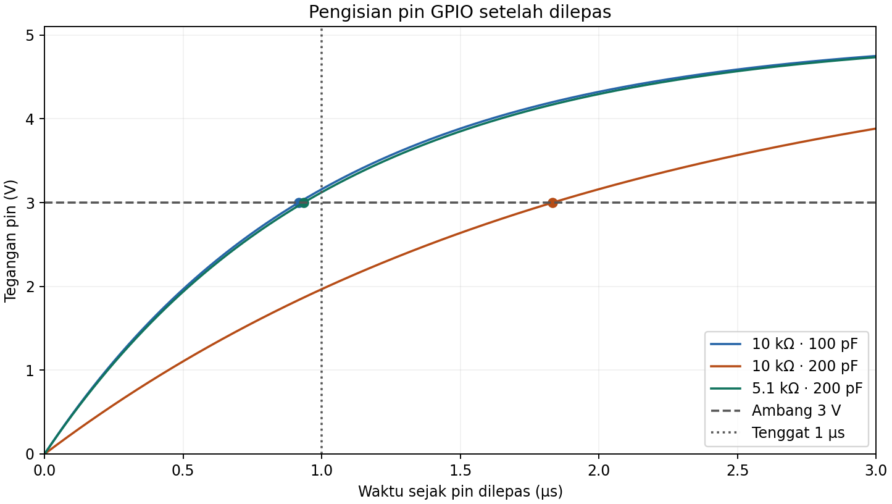

# D2.8 | Pembelaan keputusan desain
**16.00–17.00 · Lembar engineer dan penguji**

Setiap engineer membawa satu grafik dari run sendiri, netlist atau konfigurasi yang dipakai, log pengukuran, dan locator datasheet. Catat prediksi sebelum membuka hasil. Saat presentasi, jelaskan angka dari ingatan. Saat diuji, buka sumber dan jalankan ulang perintah untuk membuktikannya.

## Alokasi sesi
Satu slot berlangsung 10 menit. Untuk lima engineer, gunakan 16.00–16.50 untuk lima slot berturut-turut dan 16.50–17.00 untuk mengunci nilai, memetakan pertanyaan bacaan, serta mengisi sign-off. Untuk enam engineer, seluruh jam terpakai untuk enam slot. Catat skor per slot dan lakukan rekap setelah 17.00.

| Waktu dalam slot | Tugas engineer atau team lead |
|---|---|
| 0.00–1.00 | Sebutkan komponen, kondisi baseline, keputusan yang diuji, dan kriteria lulus dalam satuan fisik. |
| 1.00–3.00 | Baca satu grafik. Tunjuk sumbu, satuan, ambang, dan angka baseline serta variasi. |
| 3.00–4.00 | Tunjukkan prediksi awal yang gagal, besar selisih, dan asumsi yang perlu dikoreksi. |
| 4.00–5.00 | Berikan satu counterexample yang membatasi klaim. Sebutkan kondisi yang tetap sama. |
| 5.00–6.00 | Pertahankan satu keputusan desain dan sebutkan hasil yang akan mengubahnya. |
| 6.00–8.00 | Engineer menjawab lima pertanyaan wajib di bawah secara singkat. Penguji mendalami satu jawaban. |
| 8.00–10.00 | Team lead memilih secara acak satu klaim, satu parameter baseline, dan satu pengukuran. Engineer membuka sumber, menunjukkan parameter pada input, lalu menjalankan sendiri perintah hingga angka keluar. Siapkan terminal dan direktori sebelumnya. |

## Pembelaan desain · Pull-up Port 0

**Pertanyaan desain.** Saat GPIO dilepas dari kondisi LOW, berapa resistansi pull-up yang memungkinkan pin mencapai 3 V dalam 1 µs sambil menjaga arus LOW ideal ≤1 mA? Kondisi latihan menggunakan VCC 5 V dan tegangan awal 0 V. Ambang 3 V adalah target latihan. Netlist mengasumsikan sumber ideal, kapasitor lumped, tanpa kebocoran dan tanpa model transistor pad.



Grafik dan tabel ini berasal dari run pribadi saya menggunakan ngspice-47.
Pada grafik, setiap titik menandai saat tegangan pin mencapai target 3 V.
Garis vertikal pada 1 µs menunjukkan batas waktu desain.

| Resistor | Beban | Waktu mencapai 3 V | Margin terhadap 1 µs | Arus LOW ideal (hasil hitung) |
|---|---|---:|---:|---:|
| 10 kΩ | 100 pF | 0,916291 µs | +0,083709 µs | 0,50000 mA |
| 10 kΩ | 200 pF | 1,832580 µs | −0,832580 µs | 0,50000 mA |
| 5,1 kΩ | 200 pF | 0,934617 µs | +0,065383 µs | 0,98039 mA |

**Prediksi dan penyebab selisih.** Prediksi dan penyebab selisih — eksperimen reset D1.5. Sebelum simulasi, saya memperkirakan bahwa sinyal reset akan bertahan cukup lama selama tegangan catu akhirnya mencapai 5 V. Saat saya menguji kenaikan catu dari 0 ke 5 V selama 100 ms, sinyal RST sudah turun melewati ambang model pada 13,329 ms. Tegangan catu baru mencapai 4 V pada 80 ms. Artinya, model sudah melepas reset sekitar 66,7 ms sebelum catu mencapai batas bawah operasi. Prediksi saya meleset karena saya hanya memperhatikan tegangan akhir dan mengabaikan pengisian kapasitor saat catu naik perlahan.

Catatan prediksi dan koreksi tercantum di Jawaban_D1_8/reviews/day1.md, bagian Prediksi awal dan pembetulan. Hasil simulasi dan asumsi ambang model tercantum di Jawaban_D1_5/reset_hypothesis.md.

**Counterexample.** Klaim “10 kΩ cukup untuk mencapai 3 V dalam 1 µs” berlaku pada 100 pF. Dengan VCC, resistor, ambang dan kondisi awal yang sama, 200 pF memberikan contoh terukur yang menggugurkan generalisasi tersebut.

**Keputusan desain.** Untuk beban nominal 200 pF, pilih 5,1 kΩ. Dari t = −RC ln(1 − 3/5), tenggat memberi batas atas sekitar 5,46 kΩ. Dari arus LOW ideal 5 V/R, anggaran 1 mA memberi batas bawah 5,00 kΩ. Pilihan 5,1 kΩ menyisakan 65,4 ns dan sekitar 19,6 µA pada kondisi nominal. Jika R aktual turun 5% menjadi 4,845 kΩ, arus ideal menjadi sekitar 1,032 mA. Jadi toleransi komponen, variasi beban, VOL dan spesifikasi penerima perlu diperiksa sebelum keputusan untuk papan fisik.

**Cara membuktikan run sendiri di Windows.** Ekstrak seluruh ZIP. Di VS Code buka folder yang berisi scorecard.csv. Pada terminal PowerShell jalankan:

```powershell
& "$env:LOCALAPPDATA/Programs/Python/Python313/python.exe" .\bukti\run.py
```

Skrip memakai NumPy dan Matplotlib, mencari ngspice konsol, lalu membuat folder baru bernama run_pribadi_… di dalam bukti. Di folder tersebut, buka hasil.csv, grafik_pullup.png, dan lingkungan.txt. Di pullup.log, beban.log dan desain.log, cari t3 dalam detik. Contoh pemeriksaan acak: tunjukkan RP dan CL di pullup.cir, jalankan perintah batch yang tercatat di lingkungan.txt dari direktori run, lalu konversikan t3 ke µs. Setelah run, isi scorecard dengan lokasi log, angka, versi dan gambar milikmu.

**Bukti sesi.**

- Nama engineer: Ahyar Muhaemin
- Simulator: ngspice-47
- Perintah run pribadi: `py .\bukti\run.py`
- Folder bukti: `bukti/run_pribadi_xxr23_cd/`
- File hasil: `hasil.csv`, `grafik_pullup.png`, dan `desain.log` di folder bukti.
- Hasil run pribadi: pada beban 200 pF, resistor 10 kΩ mencapai 3 V dalam 1,832580 µs. Dengan resistor 5,1 kΩ, waktunya turun menjadi 0,934617 µs. Margin terhadap batas 1 µs adalah +0,065383 µs dan arus LOW ideal hasil hitung adalah 0,98039 mA.
- Angka yang dibaca saat demo: [isi saat demo bersama penguji].
- Pertanyaan acak penguji dan jawaban aktual: [isi saat tanya jawab].

## Lima pertanyaan wajib dan kunci penguji

| Pertanyaan lisan | Jawaban minimum yang dapat diperiksa | Uji pembeda |
|---|---|---|
| Apakah 10 bit menjamin galat kurang dari 1 LSB pada F330? | Untuk input unipolar ideal, 1024 kode dan LSB = Vref/1024. Pada 2,4 V, satu langkah sekitar 2,344 mV. Akurasi juga dipengaruhi offset, gain, INL, referensi, dan settling. | Pertahankan Vin. Tambahkan offset 5 mV pada model. Resolusi tetap, indikasi bergeser sekitar dua kode. |
| Mengapa reset AT89S52 bisa gagal saat VCC naik lambat? | RST harus HIGH dua machine cycle saat osilator berjalan. Tentukan irisan waktu antara catu valid, clock berjalan dan RST di atas ambang. Pada 12 MHz, dua siklus mesin klasik = 24 periode = 2 µs. | Ubah rise time catu sambil mempertahankan RC. Tunjukkan VCC dan RST serta asumsi waktu mulai clock. Model RC saja tidak membuktikan boot. |
| Apa harga yang dibayar untuk mempercepat pull-up? | Pada open-drain, arus LOW ≈ (VCC−VOL)/R dan waktu ke ambang meningkat dengan RC. P0 sebagai GPIO berbeda dari mode bus memori eksternal. | Gandakan C sambil menahan R, ukur ulang waktu ke ambang. |
| Kapan hysteresis mencegah false trigger dan kapan sinyal sah terlewat? | Setelah melintasi ambang naik, output baru kembali jika input melintasi ambang turun. Hysteresis memberi kekebalan terhadap riak yang tidak mencapai ambang balik. Pulsa sah yang terlalu kecil dapat gagal melintasi ambang. | Tambahkan riak pada ramp identik, hitung transisi ekstra dan pulsa sah yang hilang untuk dua pengaturan hysteresis. |
| Ke mana kode ADC bergerak saat Vref naik 1%? | Pada Vin absolut tetap dan jauh dari saturasi, kode ideal berbanding terbalik dengan Vref. Nilai kontinu 512 menjadi sekitar 506,93 sebelum kuantisasi. | Ulangi dengan Vin = Vref/2. Rasio ideal dan kode tetap. Catat sumber referensi pada REF0CN. |

## Sepuluh pertanyaan buku Analog | Buka setelah skor dikunci
Judul dan edisi buku belum diberikan. Kolom bab memetakan topik yang harus dicari di daftar isi. Setelah penilaian, isi nomor bab dan halaman dari buku yang digunakan.

| No. | Pertanyaan untuk hari ke-3 | Bab atau subbab yang dicari | Bab/halaman aktual |
|---|---|---|---|
| 1 | Bagaimana menurunkan waktu menuju VIH jika tegangan awal pin belum nol? | Transien RC dan kondisi awal | ___ |
| 2 | Bagaimana VOL dan kemampuan sink menentukan batas bawah R pull-up? | Antarmuka logika dan karakteristik keluaran transistor | ___ |
| 3 | Bagaimana ramp catu dan waktu mulai osilator mengubah margin reset? | Power-on reset dan supervisor tegangan | ___ |
| 4 | Bagaimana menghitung galat kuantisasi dari kurva transfer ADC ideal? | Sampling dan kuantisasi | ___ |
| 5 | Bagaimana pengukuran beberapa titik membedakan offset, gain error, dan INL? | Karakteristik statik dan pengujian ADC | ___ |
| 6 | Berapa waktu akuisisi untuk sisa galat di bawah ½ LSB setelah MUX berpindah kanal? | Sample-and-hold dan settling | ___ |
| 7 | Bagaimana drift referensi akibat suhu diterjemahkan menjadi galat tegangan sensor? | Referensi tegangan dan koefisien suhu | ___ |
| 8 | Dalam kondisi apa pengukuran rasiometrik membatalkan drift bersama? | Jembatan sensor dan pengukuran rasiometrik | ___ |
| 9 | Bagaimana memilih ambang naik dan turun dari amplitudo noise serta pulsa sah terkecil? | Komparator, umpan balik positif dan Schmitt trigger | ___ |
| 10 | Bagaimana propagation delay mengubah waktu event meskipun ambang sudah benar? | Respons dinamik komparator dan overdrive | ___ |

## Jejak sumber untuk diuji acak
- AT89S52, doc1919D, §4.3 hlm. 4 untuk mode P0, §4.7 hlm. 5 untuk reset, dan §10 hlm. 12 untuk hubungan machine cycle dengan periode osilator. [Datasheet AT89S52](https://www.microchip.com/content/dam/mchp/documents/OTH/ProductDocuments/DataSheets/doc1919.pdf)
- C8051F33x Rev. 1.7, hlm. 1 untuk cakupan varian, §5.3.3 hlm. 46 untuk settling, Bab 7 hlm. 61–62 untuk VREF dan REF0CN, serta Bab 8 hlm. 65–70 untuk Comparator0 dan hysteresis. Gunakan F330 untuk contoh ADC. [Datasheet C8051F33x](https://www.silabs.com/documents/public/data-sheets/C8051F33x.pdf)
- Manual ngspice, entri batch mode, .TRAN, .MEASURE dan plot. Cocokkan versi lokal sebelum membandingkan keluaran. [Dokumentasi ngspice](https://ngspice.sourceforge.io/docs.html)
